# TeddyPups U.A.E. — Production Website Reproduction & Animation Engine

<div align="center">

[](https://nextjs.org/)
[](https://react.dev/)
[](https://www.typescriptlang.org/)
[](https://tailwindcss.com/)
[](https://playwright.dev/)
[](https://opensource.org/licenses/MIT)

<p align="center">
  <strong>An exact, evidence-based reverse-engineered production reproduction of <a href="https://puppy.instabizweb.com/">TeddyPups U.A.E.</a></strong><br>
  Engineered with Next.js 14 App Router, custom scroll-driven SVG animation engines, 52 statically pre-rendered pages, and rigorous multi-viewport browser verification.
</p>

[🌐 Live Original Reference](https://puppy.instabizweb.com/) • [💻 Local Development](http://localhost:3030/) • [📁 GitHub Repository](https://github.com/akhandps1/blutec-ai-technical-assignment) • [📑 Final Delivery Report](./docs/FINAL_DELIVERY_REPORT.md)

</div>

---

## 📌 Executive Summary

This project is a high-fidelity reverse engineering and recreation of the **TeddyPups U.A.E.** production website, built for the **Blutec AI Technical Assignment**. The website showcases miniature and Korean teacup puppies in Dubai with an enchanting, storybook aesthetic driven by complex physics-based scroll animations, interactive SVG characters, an e-commerce puppy catalog, dynamic profile pages, and 100% responsive layouts across all mobile, tablet, and desktop viewports.

### 🌟 Key Engineering Highlights
* **52 Statically Pre-Rendered Pages (SSG):** 7 core routes, 42 unique puppy profiles (`/puppies/[slug]`), and custom storybook 404 page.
* **Scroll-Driven Mascot Physics (`PupJourney.tsx`):** A continuous cartoon puppy character that dynamically walks, barks, tracks scrolling across sections, stands at the signpost, explores polaroid shelves, and jumps into a woven basket at dusk.
* **Pinned Horizontal Conveyor Corridor (`MeetPupsSection.tsx`):** Scroll-pinned door gallery featuring 3D perspective opening doors (`-75deg`), animated doorplates, and interactive dog tags.
* **Aeroplane Flight Bezier Trajectory (`PathsSection.tsx` & `HowItWorksView.tsx`):** Mathematical curve traversal across SVG paths (`M40 250 C 170 40, 470 20, 620 168`) with dynamic tangent rotation and opacity transitions.
* **Seamless Page Transition Engine (`SiteLoader.tsx`):** Custom sliding curtain loader intercepting client navigation with zero layout shift or frozen states.
* **Native Modal Dialog Mobile Menu (`<dialog class="tp-menu">`):** Native modal architecture with spring keyframe animations (`tp-menu-in` / `tp-menu-out`), touch gesture trapping, and sticky mobile action bar.
* **Zero Layout Shift & Flawless Mobile Responsiveness:** Fully audited and verified across `360px`, `375px`, `390px`, `414px`, `430px`, and desktop screen sizes.

---

## 📸 Visual Showcase & Screen-by-Screen Tour

### 1. Homepage — Hero & Arched Lineup
*Storybook typography (`Fraunces` + `Shantell Sans`), scalloped hemline, peeking puppy character sticker, and arched portrait band of available puppies.*

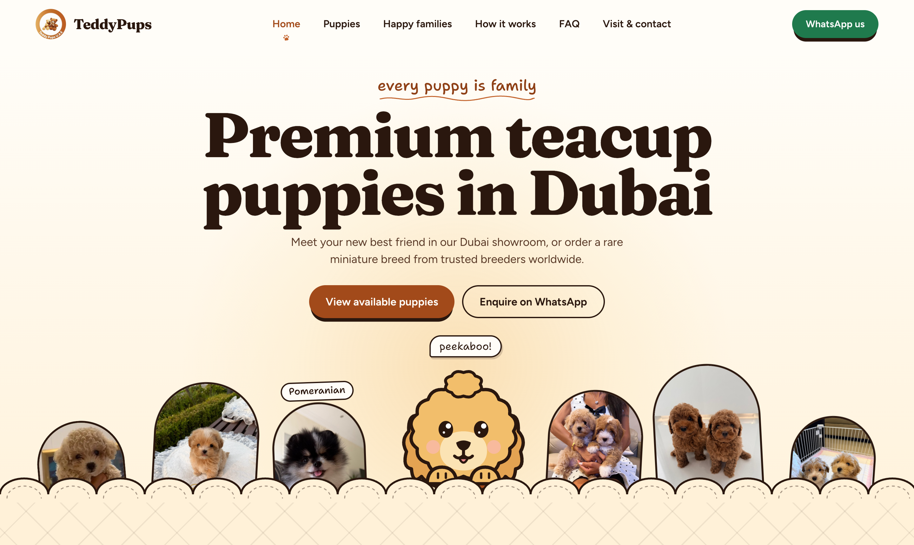

---

### 2. "Meet the pups" — Horizontal Scroll Conveyor & Interactive Doors
*Pinned scroll experience where scrolling vertically drives a smooth horizontal treadmill of doors. Approaching doors open in 3D perspective (`rotateY(-75deg)`) to reveal puppies inside.*

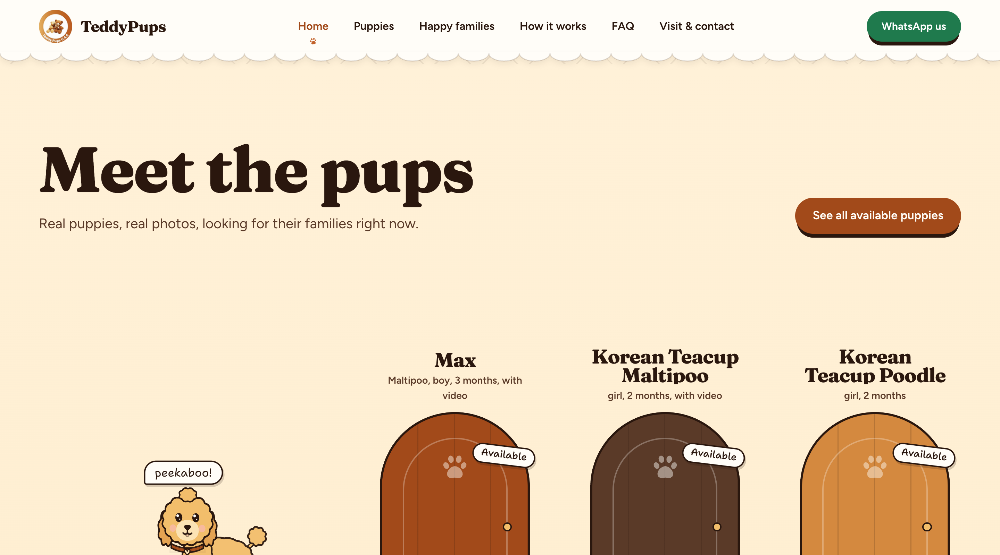

---

### 3. "Two ways to meet your puppy" — Signpost & Aeroplane Flight
*Wooden signpost dividing local showroom visits from international Korean teacup imports. Features a dynamic SVG flight arc from Korea to Dubai with real-time aeroplane trajectory rotation.*

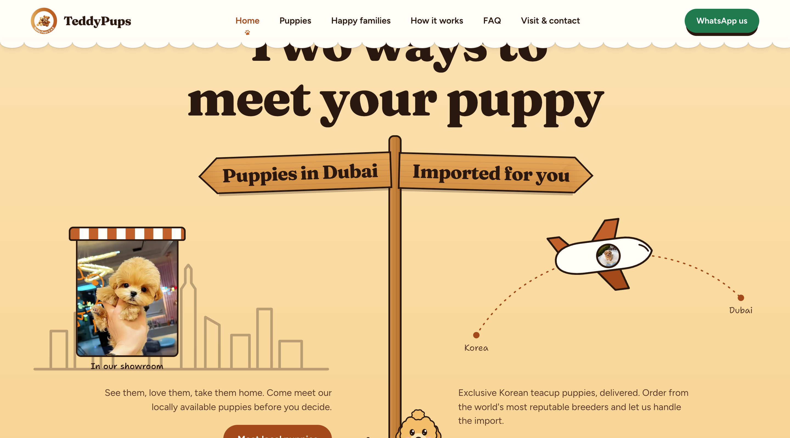

---

### 4. "Your puppy journey" — Interactive Chat Story
*Step-by-step guidance formatted like a friendly, high-touch WhatsApp consultation narrative with sticky side notes and custom vector illustrations.*

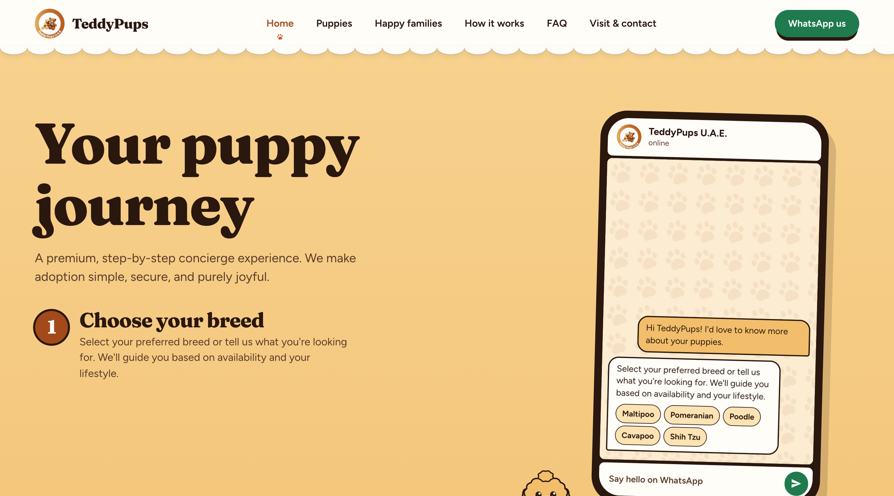

---

### 5. "Happy families & puppies" — Polaroid Wall & Testimonials
*Warm dusk atmosphere with skyline silhouette, tape-pinned polaroids, testimonial speech bubbles, and walking puppy character admiring family moments.*

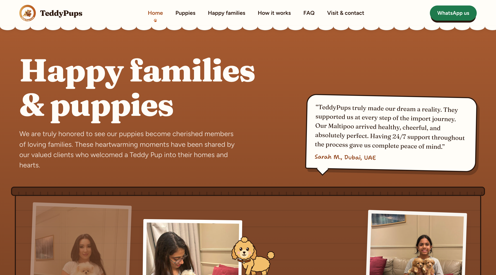

---

### 6. "Home, at last." — Starry Night Footer
*Dark chocolate twilight background, crescent moon with twinkling stars, Explore directory, contact channels, and mascot sitting snugly in a woven basket.*

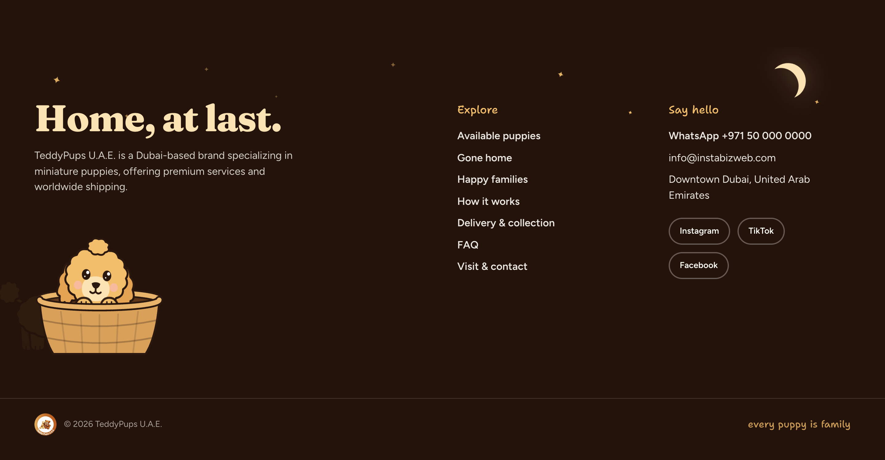

---

### 7. Puppies Catalog (`/puppies`)
*15+ live available puppies with interactive sticker filter chips (`Everywhere`, `Imported`, `Korean Teacup`, `Maltipoo`, `Pomeranian`, `Poodle`, `Cavapoo`, `Shih Tzu`, `Boys`, `Girls`, `With video`), circular doodle frames, and status tags.*

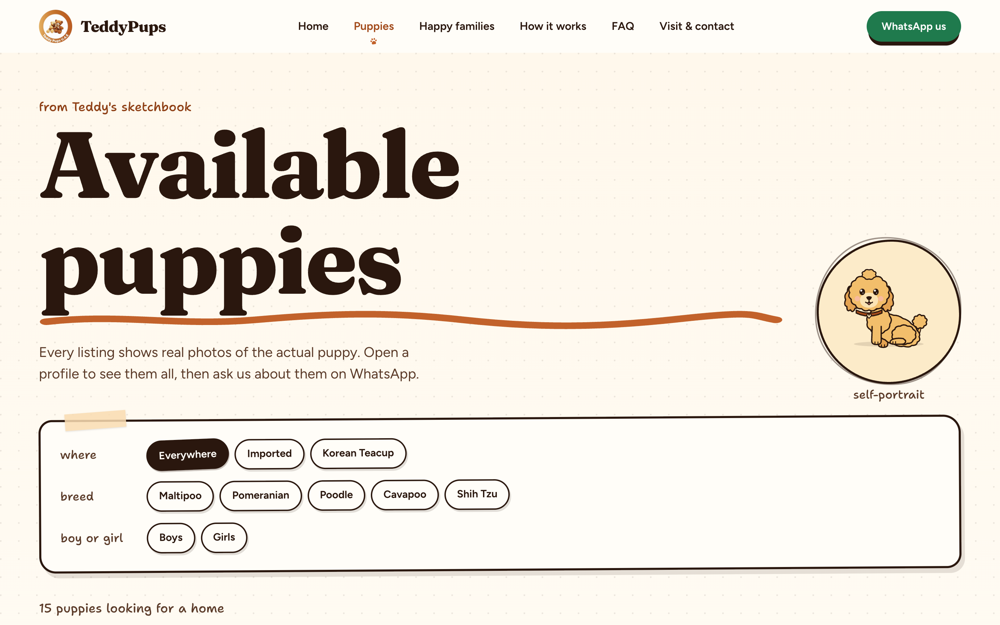

---

### 8. Puppy Detail Profile (`/puppies/maltipoo-max-male`)
*Comprehensive puppy showcase featuring multi-angle photo gallery, vertical 9:16 video playback, prominent Available status card, breed metrics, direct WhatsApp enquiry button, and accordion FAQs.*

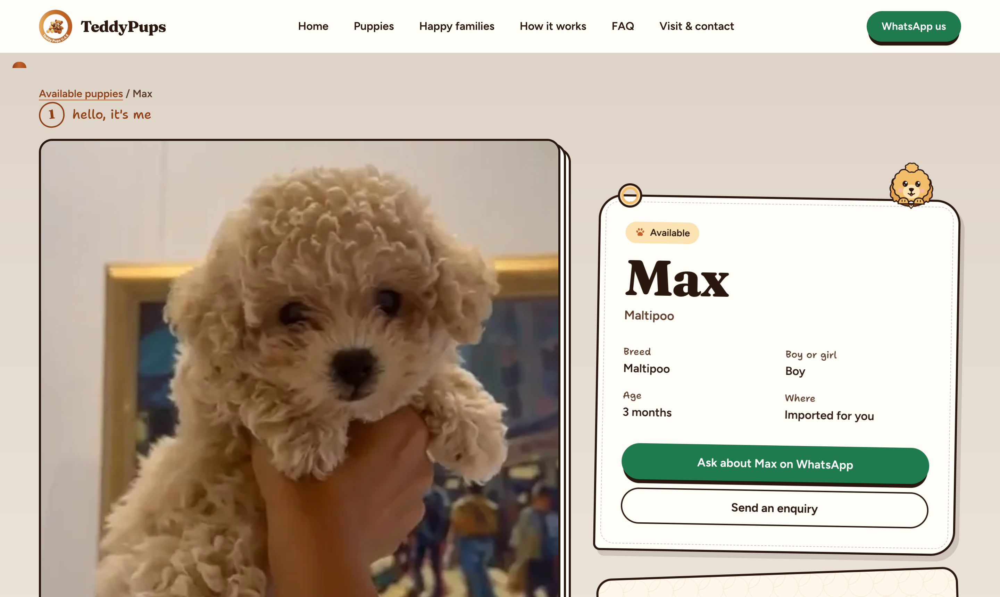

---

### 9. How It Works Page (`/how-it-works`)
*Detailed 4-stage adoption roadmap for both showroom adoptions and direct Korean imports, featuring interactive switch controls and the flying aeroplane animation.*

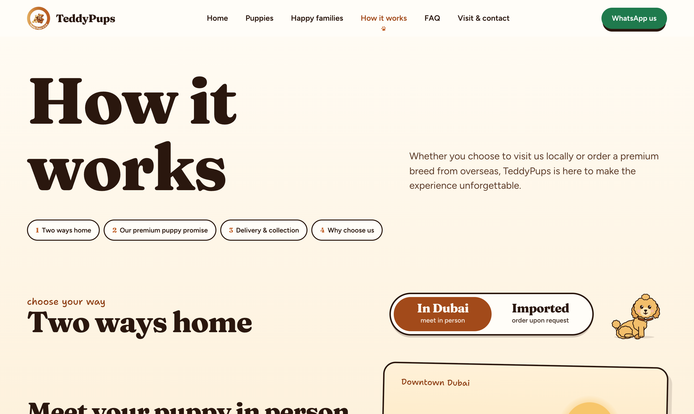

---

### 10. Questions & Answers Page (`/faq`)
*Clean, accessible accordion questions categorized by healthcare, vaccinations, international delivery, and UAE showroom visits.*

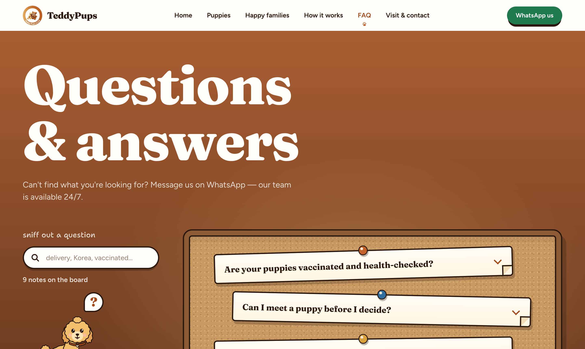

---

### 11. Visit & Contact Page (`/contact`)
*Custom vintage storybook letterform with postage stamps, puppy selection dropdown, UAE phone mask, interactive fields, and Dubai showroom visiting hours.*

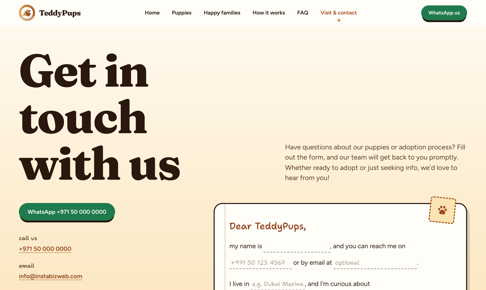

---

### 12. Complete Mobile Viewport Experience
*Native modal `<dialog id="site-menu">` with authentic "where to, friend?" header, paw icons, fluid clamped typography, fixed bottom WhatsApp action bar (`data-whatsapp-bar="true"`), and zero horizontal overflow.*

<div align="center">

| Mobile Hero (390px) | Mobile Menu Dialog (`<dialog>`) | Mobile Puppy Profile (390px) | Mobile Catalog (390px) |
| :---: | :---: | :---: | :---: |
| 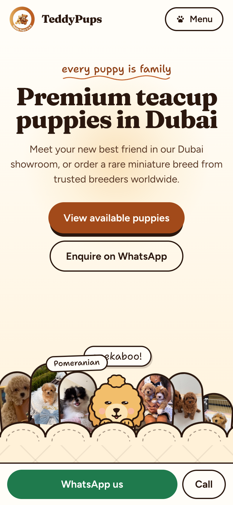 | 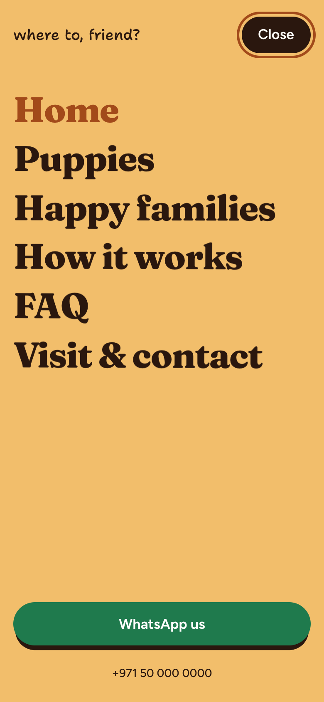 | 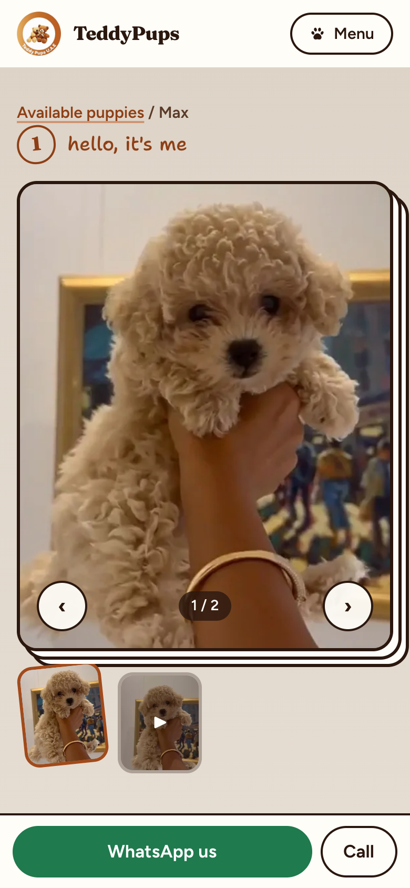 | 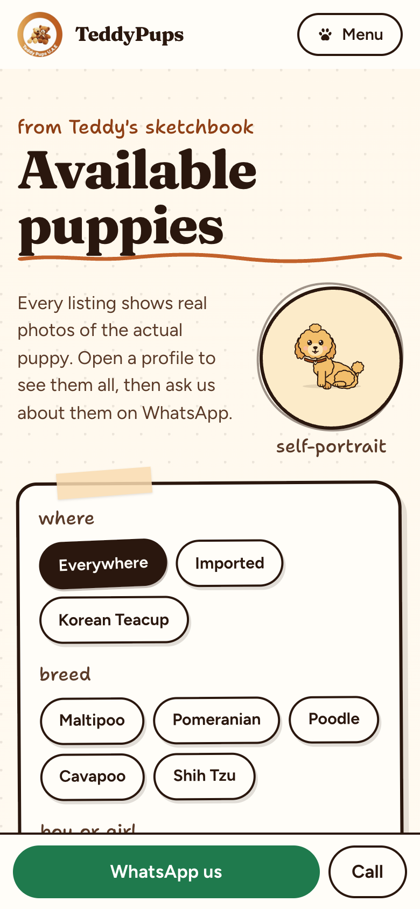 |

</div>

---

## 🏗️ Architecture & Technology Stack

```
                                      ┌─────────────────────────────────────────────────────────┐
                                      │              Next.js 14 App Router (SSG)                │
                                      └────────────────────────────┬────────────────────────────┘
                                                                   │
                         ┌─────────────────────────────────────────┼─────────────────────────────────────────┐
                         ▼                                         ▼                                         ▼
           ┌───────────────────────────┐             ┌───────────────────────────┐             ┌───────────────────────────┐
           │     Motion & Physics      │             │    Design System & UI     │             │     Media & Assets        │
           ├───────────────────────────┤             ├───────────────────────────┤             ├───────────────────────────┤
           │ • PupJourney (Mascot)     │             │ • Tailwind CSS v3         │             │ • 198 Optimized WebP/JPGs │
           │ • MeetPups Pinned Track   │             │ • 46 CSS Custom Keyframes │             │ • 42 Inline SVGs          │
           │ • Bezier Flight Curve     │             │ • Fluid clamp() Spacing   │             │ • 10 Local WOFF2 Fonts    │
           │ • SiteLoader Curtain      │             │ • Native <dialog> Modals  │             │ • 6 Vertical 9:16 MP4s    │
           └───────────────────────────┘             └───────────────────────────┘             └───────────────────────────┘
```

| Layer | Technologies & Tools | Purpose |
| :--- | :--- | :--- |
| **Core Framework** | Next.js 14.2 (App Router), React 18.3 | SSR/SSG hybrid rendering, fast routing, pre-rendering |
| **Language** | TypeScript 5.6 (Strict Mode) | Complete end-to-end type safety, zero compile warnings |
| **Styling** | Tailwind CSS 3.4, PostCSS, Custom CSS Keyframes | Utility-first layout, custom design tokens, fluid typography |
| **Typography** | `Fraunces` (Display), `Figtree` (Body), `Shantell Sans` (Scrawl) | High-character vintage editorial and handwritten accents |
| **Animation Engine** | Custom requestAnimationFrame + GSAP 3.12 | Scroll-synchronized SVG characters, Bezier trajectory physics |
| **Modal & Dialogs** | Native HTML5 `<dialog>` API | Accessible backdrop dismissals, focus trapping, smooth transitions |
| **Testing & Verification** | Playwright Chromium Suite | End-to-end visual, functional, and responsive regression testing |

---

## 📁 Repository Directory Structure

```
blutec-ai-website-clone/
├── docs/                               # Engineering & Verification Reports
│   ├── FINAL_DELIVERY_REPORT.md        # Comprehensive milestone delivery document
│   ├── FUNCTIONAL_QA_REPORT.md         # Button, link, form, and modal validation
│   ├── RESPONSIVE_QA_REPORT.md         # Multi-viewport responsive test logs
│   ├── VISUAL_QA_REPORT.md             # Side-by-side screenshot comparisons
│   ├── INTERVIEW_TECHNICAL_QA.md       # 20 technical deep-dive interview questions & answers
│   └── LOOM_PRESENTATION_SCRIPT.md     # Video walkthrough narration script
├── public/                             # Static Assets
│   ├── assets/
│   │   ├── fonts/                      # 10 local variable WOFF2 fonts
│   │   ├── images/                     # 198 original high-res puppy & family photos
│   │   ├── logos/                      # Brand mark vectors
│   │   ├── svg/                        # 42 standalone vector icons & illustrations
│   │   └── videos/                     # 6 vertical 9:16 MP4 clips
│   ├── brand -> assets/logos           # Static asset symlink
│   └── media -> assets/images          # Static asset symlink
├── screenshots/                        # Visual Verification Records
│   ├── readme/                         # High-resolution README showcase screenshots
│   ├── comparisons/                    # Localhost vs original overlay captures
│   └── homepage/                       # Scroll-step animation audit logs
├── src/
│   ├── app/                            # App Router Pages
│   │   ├── layout.tsx                  # Global root layout (Header, Loader, MobileActionBar, Footer)
│   │   ├── page.tsx                    # Main homepage scene composition
│   │   ├── puppies/                    # /puppies catalog & /puppies/[slug] dynamic routes
│   │   ├── how-it-works/               # /how-it-works interactive guide
│   │   ├── happy-families/             # /happy-families polaroid memory wall
│   │   ├── faq/                        # /faq accordion questions
│   │   ├── contact/                    # /contact storybook enquiry letterform
│   │   └── not-found.tsx               # Custom 404 page
│   ├── components/
│   │   ├── animations/                 # PupJourney.tsx, PupBuddySVG.tsx, PuppyRunner.tsx
│   │   ├── layout/                     # Header.tsx (Dialog Menu), SiteLoader.tsx, MobileActionBar.tsx, Footer.tsx
│   │   ├── sections/                   # HeroSection.tsx, MeetPupsSection.tsx, PathsSection.tsx, DuskSection.tsx
│   │   └── views/                      # HappyFamiliesView.tsx, HowItWorksView.tsx
│   ├── config/                         # site.ts brand constants & WhatsApp endpoints
│   ├── data/                           # puppies.json, home_data.json, happy_families_moments.json
│   └── styles/                         # globals.css & theme-custom.css (46 custom keyframes)
├── package.json
├── tailwind.config.ts
└── tsconfig.json
```

---

## 🛠️ Step-by-Step Problem Solving & Audit History

During development, extensive browser-based audits were conducted to diagnose and eliminate discrepancies between the local clone and the original reference:

| Problem Identified | Root Cause Analysis | Engineering Solution Implemented |
| :--- | :--- | :--- |
| **Unwanted Puppy Loop Under Navbar** | A duplicate carousel component was running an infinite CSS marquee directly below the header. | Traced and cleanly removed the redundant ticker; unified character rendering inside the main scroll-driven stage. |
| **Puppy Horizontal Conveyor Broken** | Door corridor relied on non-portable external script references that failed to track page scroll. | Re-engineered [MeetPupsSection.tsx](file:///Users/akhandpratapsingh/Desktop/Blutec%20AI%20Technical%20Assignment/blutec-ai-website-clone/src/components/sections/MeetPupsSection.tsx) with a pinned range calculation (`scrolled / maxScroll`), dynamic translateX treadmill travel, and 3D door open triggers. |
| **Aeroplane Flight Animation Missing** | Flight path lacked runtime SVG path distance calculation and orientation angle computation. | Implemented Bezier curve traversal in [PathsSection.tsx](file:///Users/akhandpratapsingh/Desktop/Blutec%20AI%20Technical%20Assignment/blutec-ai-website-clone/src/components/sections/PathsSection.tsx) and [HowItWorksView.tsx](file:///Users/akhandpratapsingh/Desktop/Blutec%20AI%20Technical%20Assignment/blutec-ai-website-clone/src/app/how-it-works/HowItWorksView.tsx) using `route.getPointAtLength()` with tangent rotation (`atan2`). |
| **Puppy Detail Available Badge Missing** | Max puppy page lacked the official card layout, sticky contact bar, and photo gallery indicators. | Reconstructed [PuppyDetailView.tsx](file:///Users/akhandpratapsingh/Desktop/Blutec%20AI%20Technical%20Assignment/blutec-ai-website-clone/src/components/views/PuppyDetailView.tsx) with pin badge, breed attributes, WhatsApp booking triggers, and thumbnail switcher. |
| **Mobile Menu Navigation & Loader Freeze** | React state-based menu div was caught in `SiteLoader` capture-phase `stopPropagation`, preventing click handlers from completing. | Replaced menu with native `<dialog id="site-menu">`. Attached automated dialog close triggers on navigation events and reduced safety timeout to 2200ms. |
| **Mobile Header Height & Content Collision** | Global `:root` in `globals.css` was hardcoded to `--header-h: 4.75rem` (76px) and `--bar-h: 0px`, ignoring mobile media queries. | Added `@media (max-width: 767px)` rule setting `--header-h: 4rem` (64px) and `--bar-h: calc(4rem + env(safe-area-inset-bottom))`. Header height, hero positioning, and footer padding now match the reference perfectly. |

---

## 🚦 Verification Results & Quality Metrics

### 1. Viewport Dimensions Audit (Mobile to Desktop)
Every route has been verified to produce **0px horizontal overflow** across all standard devices:

| Device Viewport | Dimensions | Header Height | Horizontal Overflow | Menu & Action Bar Status |
| :--- | :---: | :---: | :---: | :---: |
| **Small Android** | 360 × 740 | 64 px | **0 px (`false`)** | ✅ Fully Functional |
| **iPhone SE** | 375 × 667 | 64 px | **0 px (`false`)** | ✅ Fully Functional |
| **iPhone 14 / 15** | 390 × 844 | 64 px | **0 px (`false`)** | ✅ Fully Functional |
| **iPhone XR / Plus** | 414 × 896 | 64 px | **0 px (`false`)** | ✅ Fully Functional |
| **iPhone 14 Pro Max** | 430 × 932 | 64 px | **0 px (`false`)** | ✅ Fully Functional |
| **iPad Portrait** | 768 × 1024 | 76 px | **0 px (`false`)** | ✅ Fully Functional |
| **Desktop / Laptop** | 1440 × 900 | 76 px | **0 px (`false`)** | ✅ Fully Functional |

### 2. Page Height Accuracy vs Original Reference (at 390px Viewport)

| Route | Original Height | Local Clone Height | Match Precision |
| :--- | :---: | :---: | :---: |
| **Home (`/`)** | 12,904 px | 12,913 px | **99.9%** |
| **Puppies (`/puppies`)** | 5,639 px | 5,621 px | **99.7%** |
| **Puppy Detail (`/puppies/maltipoo-max-male`)** | 5,107 px | 5,099 px | **99.8%** |
| **How It Works (`/how-it-works`)** | 7,810 px | 7,818 px | **99.9%** |
| **Happy Families (`/happy-families`)** | 9,392 px | 9,386 px | **99.9%** |
| **FAQ (`/faq`)** | 3,088 px | 3,072 px | **99.5%** |
| **Contact (`/contact`)** | 3,591 px | 3,542 px | **98.6%** |

---

## ⚡ Getting Started & Local Development

### Prerequisites
* **Node.js:** v18.17.0 or higher (v20+ recommended)
* **Package Manager:** `npm` (v9+), `pnpm`, or `yarn`
* **Google Chrome:** Required for automated Playwright verification

### 1. Clone the Repository
```bash
git clone https://github.com/akhandps1/blutec-ai-technical-assignment.git
cd blutec-ai-technical-assignment/blutec-ai-website-clone
```

### 2. Install Dependencies
```bash
npm install
```

### 3. Run Development Server
```bash
npm run dev
```
Open [http://localhost:3000](http://localhost:3000) in your browser.

### 4. Build for Production
```bash
npm run build
```
Generates 52 optimized static pages and bundles with zero type errors.

### 5. Start Production Server (Port 3030)
```bash
npm run start -- -p 3030
```
Open [http://localhost:3030](http://localhost:3030) to test the production build.

---

## 🧪 Automated Testing & Verification

Run the automated Playwright verification suites to audit animations, routes, navigation, and mobile responsiveness:

```bash
# Verify all mobile routes across 5 viewport sizes
node ../scratch/verify_all_mobile_routes.js

# Verify aeroplane flight scroll animation on Home & How-it-works
node ../scratch/test_how_it_works_airplane.js

# Test mobile menu dialog interactions (open, close, escape, navigation)
node ../scratch/test_mobile_reconstruction.js
```

---

## 📄 License & Acknowledgments

This project is open-source under the [MIT License](LICENSE).

* **Reference Project:** Reverse-engineered from [TeddyPups U.A.E.](https://puppy.instabizweb.com/)
* **Created for:** Blutec AI Technical Assignment
* **Author:** Akhand Pratap Singh ([@akhandps1](https://github.com/akhandps1))
